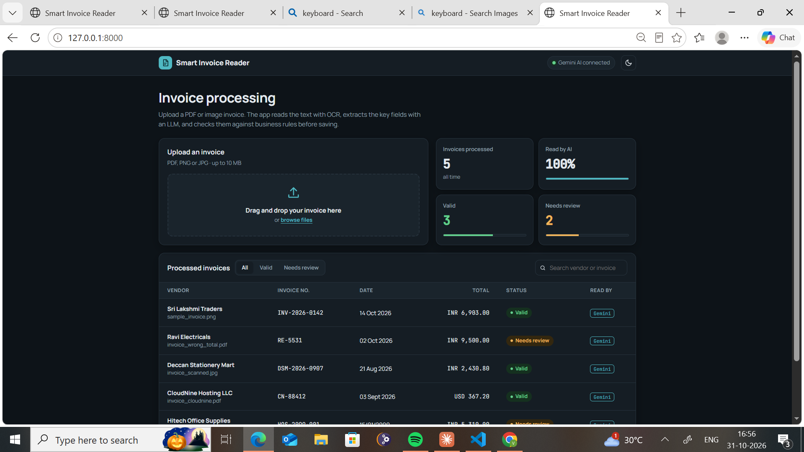

# Smart Invoice Reader

An AI-powered invoice processing app. Upload an invoice (PDF, PNG or JPG) and it:

1. **Reads the text**: directly from digital PDFs, or with **OCR (Tesseract + OpenCV pre-processing)** for images and scanned pages.
2. **Extracts the key fields** (invoice number, date, vendor, currency, total, line items) using an **LLM (Google Gemini)** that returns structured JSON. If no API key is set or the call fails, it falls back to **regex rules**.
3. **Validates** the result with business rules: required fields, real and non-future dates, quantity × price = amount, and line items adding up to the total (allowing for tax).
4. **Saves** it to a database (SQLite by default, MySQL supported) and shows it in a simple web page, marked **valid** or **needs review**.

> Live demo: _add your Render link here_ · Demo video: _add your link here_



## Tech stack
Python · FastAPI · Pydantic · SQLAlchemy · SQLite/MySQL · Tesseract OCR · OpenCV · PyMuPDF · Google Gemini API · HTML/JavaScript · pytest · Docker

## How it works
```
Upload ──▶ Text extraction ──▶ Field extraction ──▶ Validation ──▶ Database ──▶ Web page / JSON API
           (PDF text or OCR)   (Gemini LLM, or      (business
                                regex fallback)      rules)
```

| File | What it does |
|---|---|
| `app/ocr.py` | Reads PDFs directly; pre-processes images with OpenCV and runs Tesseract OCR |
| `app/extractor.py` | Sends the text to Gemini with a prompt asking for JSON; regex fallback |
| `app/validator.py` | Business rules that flag invoices for human review |
| `app/models.py`, `app/database.py` | SQLAlchemy table and database session |
| `app/main.py` | FastAPI routes and the pipeline |
| `app/static/index.html` | Upload page and results table |
| `tests/` | 18 pytest tests (validator, extractor, full API) |

## API
| Method | Endpoint | Description |
|---|---|---|
| POST | `/api/invoices` | Upload a file; returns the extracted, validated invoice |
| GET | `/api/invoices` | List all processed invoices |
| GET | `/api/invoices/{id}` | Get one invoice |
| DELETE | `/api/invoices/{id}` | Delete an invoice |
| GET | `/health` | Health check |

Interactive API docs are at `/docs` when the app is running.

## Run it locally (Windows)
1. Install [Python 3.12+](https://www.python.org/downloads/) and [Tesseract OCR](https://github.com/UB-Mannheim/tesseract/wiki).
2. Get a free Gemini API key from [Google AI Studio](https://aistudio.google.com/apikey).
3. In the project folder:
   ```
   py -m venv .venv
   .venv\Scripts\activate
   pip install -r requirements.txt
   copy .env.example .env
   ```
4. Open `.env` and paste your `GEMINI_API_KEY` (and `TESSERACT_CMD` if needed).
5. Create the sample invoices and start the app:
   ```
   python samples/make_samples.py
   uvicorn app.main:app --reload
   ```
6. Open http://127.0.0.1:8000 and upload any file from `samples/`. `invoice_wrong_total.pdf` and `invoice_future_date.pdf` contain deliberate mistakes, so they should be flagged **needs review**.

Run the tests with `python -m pytest`.

## What I learned
- How OCR accuracy depends on image pre-processing (grayscale, resizing, thresholding) and page-segmentation mode.
- How to get reliable structured output from an LLM: clear prompt, temperature 0, JSON response mode, and never trusting the output without validation.
- Designing a fallback so the app still works when the AI service is unavailable.
- Building and testing a REST API with FastAPI, Pydantic and SQLAlchemy.

## Future improvements
- Human review screen to correct "needs review" invoices
- Support for multi-page invoices with several tables
- Export to Excel / CSV
- User login
